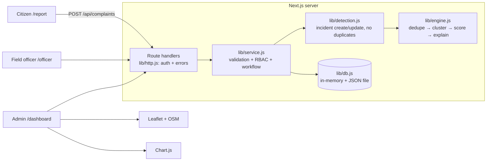

# CivicSignal 2.0 — Detect Patterns. Prevent Public Failures.

Infrastructure risk intelligence & early-warning MVP (Next.js 14 App Router).
It correlates **complaint frequency, geography, timing, category similarity, maintenance records and a historical baseline** to flag *potential* infrastructure incidents, and explains every alert.

> ⚠ **All data is SIMULATED** (fictional municipality, synthetic complaints/assets/records). An alert is a **risk signal, not proof** of contamination or failure; every alert needs human verification. Not production-grade security, no government integration.

## Quick start
```bash
npm install
cp .env.example .env.local     # AUTH_SECRET badlo
npm run dev                    # http://localhost:3000
npm test                       # engine + end-to-end flow tests (Node >= 20)
npm run seed                   # optional: fresh data/db.json
```
First request par DB auto-seed hota hai (128 complaints, 20 assets, 12 maintenance records, 2 detected incidents).

## Demo accounts (password `demo123`)
| Role | Email |
|---|---|
| Municipal administrator | admin@civicsignal.demo |
| Field officer | officer1@civicsignal.demo (Meera Rao), officer2@civicsignal.demo (Arjun Sen) |

## 9-step demo (works in the real app)
1. `/report` → **Demo: fill Green Park report** → Submit (citizen, no login). You get ID like `CS-2026-000129`.
2. Green Park already has 5 simulated nearby complaints (below the alert minimum of 6, shown as a dashed "watched" circle).
3. On submit the detection engine re-analyses space + time.
4. A new incident (`INC-0003`, risk *High*) is created — only once, never duplicated.
5. `/login` as admin → alert on dashboard list + map.
6. Open the incident → **Assign** to Officer Meera Rao.
7. Login as officer1 → `/officer` → submit inspection (observations, water sample values, photo).
8. Officer clicks **Mark VERIFIED** (only authorised officers can verify) → admin **Records resolution**. Admin can also **Dismiss** with a reason.
9. KPI cards update: verified / resolved counts, average response time.
"Reset demo data" button (admin) re-seeds so you can repeat.

Seed also contains: a critical *dirty-water* incident (Shanti Colony, 11 dirty + 7 low-pressure + recent pipeline repair), a *pipeline-leakage* incident (Model Town East + valve breakdown), an **undetected** cluster (Industrial Sector 7, 3 sewage overflows), scattered individual complaints and 6 near-duplicates.

## Architecture


## Detection engine (`lib/engine.js`)
1. **Near-duplicate removal** — same category, ≤ 50 m, ≤ 6 h → not counted.
2. **Time window** — only complaints in the last `windowHours` (48 h).
3. **Category groups** — `water_supply` (dirty water, low pressure, no supply, leakage) and `sewage_drainage` are clustered separately.
4. **Geographic clustering** — greedy centroid clustering within `radiusM` (1000 m).
5. **Alert** if cluster has ≥ `minComplaints` (6) unique complaints; smaller clusters (≥2) are returned as *watch* items.
6. **Signals** — volume, related categories, time concentration, recent maintenance/breakdown within radius, ratio to the previous `baselineDays` baseline, health-sensitive category.
7. **Experimental risk score (0–100)** = sum of transparent factor points (weights in `lib/constants.js`), shown with a per-factor breakdown. Levels: low / moderate (≥35) / high (≥55) / critical (≥75). It is **not** a validated probability.
8. Every alert answers: what happened, where, why flagged, evidence, what to verify next.

All rules are editable in **Dashboard → Detection settings** (minimum count, window, radius, maintenance lookback, baseline, thresholds).

## Roles & permissions (enforced in `lib/service.js`, i.e. backend)
| Action | Admin | Field officer | Citizen |
|---|---|---|---|
| Submit complaint | – | – | ✔ (public, rate-limited) |
| View dashboard data | ✔ | own assigned incidents only | – |
| Assign incident / register asset / settings / reset | ✔ | – | – |
| Add maintenance / breakdown | ✔ | ✔ | – |
| Submit inspection | – | ✔ (assigned only) | – |
| **Verify** incident | ✘ | ✔ (assigned, after inspection) | – |
| Dismiss | ✔ (reason) | ✔ (after inspection) | – |
| Resolve (final resolution) | ✔ (verified only) | – | – |

> Note: spec step 8 says "administrator marks verified or dismissed" while §E says only authorised officers may verify. Implemented as: **officer verifies, administrator dismisses/resolves** (admin cannot verify).

## API (JSON, cookie session `cs_session`)
| Method & path | Who | Purpose |
|---|---|---|
| POST `/api/login`, `/api/logout`, GET `/api/me` | all | session |
| POST `/api/complaints` | public | submit; returns complaint ID, runs engine |
| GET `/api/complaints` | staff | list (images omitted) |
| GET `/api/complaints/:id/image` | staff | photo |
| GET/POST `/api/assets` | staff / admin | registry |
| GET/POST `/api/maintenance` | staff | maintenance & breakdown records |
| GET `/api/incidents` | staff | incidents (+ `watch` clusters for admin) |
| GET `/api/incidents/:id` | staff | detail, complaints, history |
| POST `/api/incidents/:id/assign` `{officerId}` | admin | assign |
| POST `/api/incidents/:id/inspection` | officer | observations, finding, waterSample, evidence |
| POST `/api/incidents/:id/decision` `{decision: verified\|dismissed, note}` | officer / admin | decide |
| POST `/api/incidents/:id/resolve` `{resolution}` | admin | close verified incident |
| GET `/api/stats` | staff | KPIs |
| GET/PUT `/api/config` | admin | rules |
| POST `/api/detect`, `/api/demo/reset` | admin | re-run engine / reseed |

## Data store (documented alternative)
The spec prefers PostgreSQL + PostGIS. For a zero-setup hackathon prototype this MVP uses an **in-memory store persisted to `data/db.json`** (`lib/db.js`). Distances use the haversine formula in JS. Collections: `users, complaints, assets, maintenance, incidents(+inspections, history), config, counters`. To move to Postgres/PostGIS, replace `lib/db.js` and the array operations in `lib/service.js` / `lib/detection.js` (`ST_DWithin` for radius queries).

## Deployment
* **Local / VM / Render / Railway:** `npm run build && npm start` — file persistence works (set `CIVIC_DB_PATH` to a persistent disk).
* **Vercel:** works, but the filesystem is read-only, so data lives in memory / `/tmp` and **resets on cold start** (fine for demos; use a real DB for anything else). Set `AUTH_SECRET` in project env.
* Leaflet tiles come from the public OpenStreetMap tile server — fine for demos, follow OSM tile usage policy or use a tile provider for traffic.

## Tests (`npm test`)
`tests/engine.test.js` — haversine, geographic clustering, time window, configurable rules, category-group separation, duplicate exclusion, risk classification, maintenance signal + explanation, seed scenario (2 detected + undetected clusters, reproducible).
`tests/flow.test.js` — full citizen → engine → assign → inspect → verify → resolve → stats flow, role/permission rejections, no duplicate incidents, closed-incident cooldown, input validation, login.

## Known limitations
* Prototype storage (JSON file / memory), single server instance; no migrations or concurrency control.
* Demo auth only (HMAC-signed cookie, seeded users, scrypt hashes). No CSRF tokens, MFA, audit-grade logging, or password reset. **Not production-grade security.**
* Pipelines/sewer lines are single points, not line geometries. Coordinates of the fictional municipality are arbitrary and clearly labelled simulated.
* Greedy clustering is order-dependent for borderline cases; density layer is a simple 300 m grid.
* Baseline uses only the seeded 30-day history; thresholds/weights are heuristic, not calibrated.
* Photos are stored inline (client-resized, ≤ ~330 KB). No object storage.
* Citizen "date/time" is trusted within the last 30 days; no spam/abuse detection beyond a per-IP rate limit.
* "District administrator" view = the administrator dashboard (no separate multi-municipality view yet).
* Auto-refresh polls every 20 s (no websockets).
